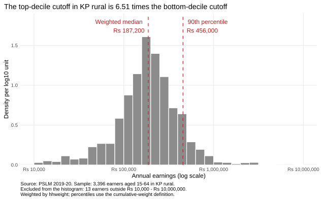
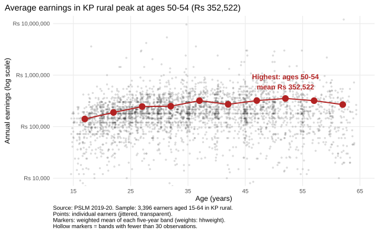
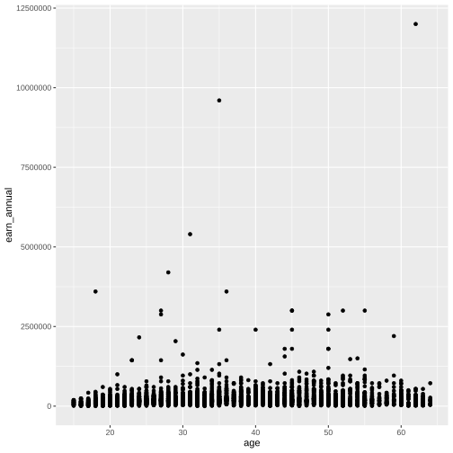
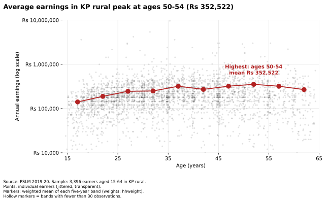

# ECO346-A1-FA24-BEDS-020

**ECO346 Data Visualization Techniques for Economists, Assignment 1, Fall 2026 (Section A)**

## My variant

Last two digits of my registration number: 20 = 2 x 8 + 4, so **variant 4: KP rural**
(`prov_code` = 1, `urban_rural` = 1). All results use only persons in this variant,
aged 15-64 with `earn_annual` > 0 ("earners"): **3,396 earners**, every statistic weighted by `hhweight`.

## How to reproduce (no internet needed)

Run from the repository root. The variant is read from `reg.txt`.

```
Rscript scripts/01_default.R        # figures/default.svg
Rscript scripts/02_distribution.R   # figures/distribution.svg, results/q2_numbers.csv
Rscript scripts/03_relationship.R   # figures/relationship.svg, results/band_table_R.csv
python  scripts/04_second_language.py   # figures/relationship_py.svg, results/band_table_python.csv
```

Requirements: R 4.1+ with `dplyr`, `readr`, `ggplot2`, `scales`, `svglite`; Python 3 with `pandas`, `numpy`, `matplotlib`.

## Figures

**Question 2: the distribution** (`figures/distribution.svg`)



**Question 3: the relationship / Question 4: the redesign** (`figures/relationship.svg`)



**Question 4: R's default figure** (`figures/default.svg`)



**Question 5: same figure drawn in Python** (`figures/relationship_py.svg`)



## Question 2: results

| Statistic | Value |
|---|---:|
| Number of earners | 3,396 |
| Weighted median | Rs 187,200 |
| Unweighted median | Rs 180,000 |
| Weighted 10th percentile | Rs 70,000 |
| Weighted 90th percentile | Rs 456,000 |
| Ratio p90 / p10 | 6.51 |
| Earners excluded from the histogram (outside Rs 10,000-Rs 10,000,000) | 13 |

**Interpretation.** Earnings in KP rural cluster around Rs 158,000-Rs 200,000 but spread widely: the 90th percentile (Rs 456,000) is 6.51 times the 10th (Rs 70,000), with a long right tail (mean above median). The weighted median (Rs 187,200) is higher than the unweighted (Rs 180,000): hhweight undoes the oversampling of small districts, and earnings correlate positively with household weight (Spearman 0.05).

## Question 3: band table

| Band | Number of earners | Weighted mean earnings (Rs) |
|---|---:|---:|
| 15-19 | 240 | 141,017 |
| 20-24 | 487 | 188,635 |
| 25-29 | 466 | 245,584 |
| 30-34 | 473 | 249,828 |
| 35-39 | 412 | 319,166 |
| 40-44 | 340 | 271,420 |
| 45-49 | 385 | 320,463 |
| 50-54 | 251 | 352,522 |
| 55-59 | 199 | 319,492 |
| 60-64 | 143 | 268,087 |

"Thin" = fewer than 30 unweighted observations (hollow marker in the figure).
Bands 25-29: Rs 245,584; 45-49: Rs 320,463; highest weighted mean: **50-54** (Rs 352,522).

**Interpretation.** Mean earnings rise from Rs 141,017 at ages 15-19 to a peak of Rs 352,522 at 50-54, then fall to Rs 268,087 at 60-64. That is the classic experience profile: human capital accumulates, then flattens near retirement. But the age gain (2.5x from youngest to peak) is smaller than the 90th/10th percentile ratio (6.51), so people of the same age differ more than age groups do. It cannot tell us whether one worker's earnings will follow this path: it is a single cross-section, so age is confounded with cohort and selection into work.

## Question 4: the makeover

`figures/default.svg` is R's untouched `ggplot(data, aes(x, y)) + geom_point()`, committed before the redesign.

1) Log vertical axis: earnings are right-skewed, so the linear default crushes most earners near the bottom; a log scale makes proportional differences comparable. 2) Transparency (alpha 0.15) and horizontal jitter (+/-0.4 years): 3,396 points at whole-year ages overplot into solid columns; now density is visible. 3) Weighted band means, joined by a line and annotated directly: position on a common scale is the most accurate channel, and conditional means reveal the age pattern the cloud hides. I also removed clutter and added rupee labels and a finding title (data-ink). What the default shows and the redesign hides: the top earner (Rs 12,000,000) towering over everyone on the linear axis, the true extremity of the right tail.

## Question 5: a second language (Python)

25-29 band mean: Rs 245,584 in R and Rs 245,584 in Python (all ten bands agree to the rupee; `scripts/04_second_language.py` checks this against `results/band_table_R.csv`).

Axis defaults differed: matplotlib's log axis prints scientific tick labels with minor ticks, unlike my ggplot rupee labels. I fixed ticks at 10^4-10^7, formatted them as rupees, set the same limits (Rs 10,000-10,000,000), and matched alpha, point size, jitter (+/-0.4) and band edges (right=False). The band tables agree to the rupee; the 25-29 mean is Rs 245,584 in both.

## Definitions and choices

- Weighted mean = sum(w x) / sum(w). Weighted p-th quantile: sort by x, take the smallest x whose cumulative weight share is at least p (not R's `quantile()`).
- The number of earners, the medians and the percentiles use all earners in the variant; only the histogram drops earners outside Rs 10,000-Rs 10,000,000.
- Histogram: 30 bins, 0.1 wide in log10 units from 4.0 to 7.0; density = bin weight / total weight of the plotted earners / 0.1.
- Age bands are [15,20), [20,25), ..., [60,65), plotted at midpoints 17, 22, ..., 62.
- Points: alpha 0.15, jitter +/-0.4 years horizontally (never vertically).

## Repository structure

```
README.md  reg.txt  ECO346-A1.Rproj
data/      pslm_person_subset.csv, pslm_hh_subset.csv
scripts/   00_helpers.R, 01_default.R, 02_distribution.R, 03_relationship.R, 04_second_language.py
figures/   default.svg, distribution.svg, relationship.svg, relationship_py.svg
results/   q2_numbers.csv, band_table_R.csv, band_table_python.csv
slides/    FA24-BEDS-020.pptx
```
